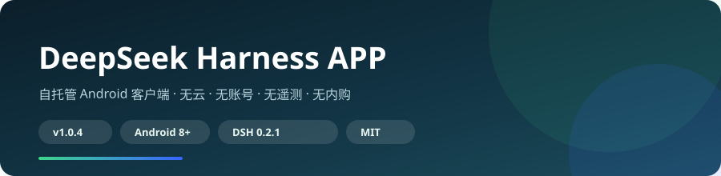
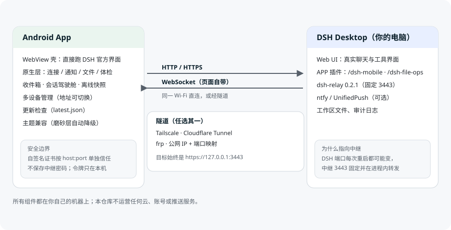
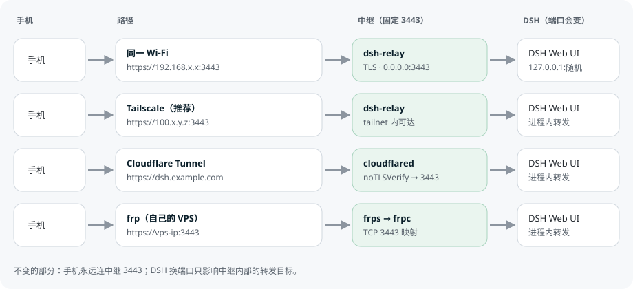
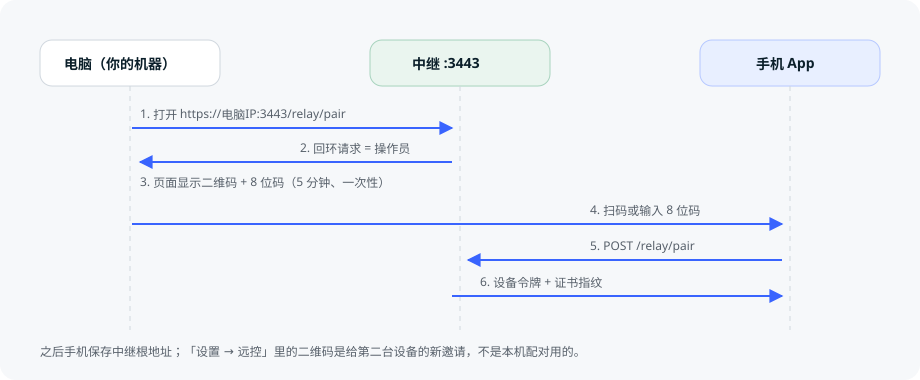

<div align="center">


# DeepSeek Harness APP

**自托管 Android 客户端，给跑在你自己机器上的 DeepSeek Harness（DSH）用。**

手机是壳，界面是官方 DSH；原生层补上浏览器给不了的能力。

[](https://github.com/daniei-chen/DeepSeek-Harness-APP/releases/latest)
[](#下载)
[](#架构)
[](LICENSE)

**无云 · 无账号 · 无遥测 · 无内购** · 非官方社区项目

</div>



---

## 30 秒了解

| 你得到什么 | 说明 |
| --- | --- |
| **官方界面，手机上用** | WebView 里跑的就是 DSH 官方 Web UI，不是重新画的聊天界面 |
| **连你自己的服务器** | 直连 HTTP/HTTPS、局域网、relay 中继、Tailscale/Cloudflare/frp 隧道都支持 |
| **审批能直接处理** | 通知上带「同意 / 拒绝」，不用先打开网页 |
| **文件能管** | 上传、重命名、新建、下载、打包、递归删除、文本/图片预览 |
| **出问题能说清** | 连接体检、通知自检、离线快照、页面事件时间线 |
| **升级不靠人记** | 自托管 `latest.json`，版本号严格递增，覆盖安装即可 |
| **2.5 MB 的安装包** | 1.1.0 删掉了 9.4 MB 用不到的原生 OCR，下载和升级都快了 5 倍 |
| **分享进来，通知里直接回** | 任何 app 都能把文字/链接分享进来；完成和提问通知带回复框 |

> ⚠️ 这是一个**非官方**项目，与 DeepSeek 官方无关。「DeepSeek Harness」与鲸鱼标识归其各自所有者。

---

## 1.1.3：重连不误报、模型名完整

| 问题 | 修法 |
| --- | --- |
| Wi-Fi 抖一下就报「连接失败」 | 失败不再逐次上报：连续 3 次失败**且**持续 8 秒以上才显示错误，成功立刻清空。期间状态只显示"重连中"。 |
| 「一直重连」停不下来 | 连续 20 次失败或持续 3 分钟就刹车：停止自动重连，并明确告知"需要手动重连"。手动连接/网络恢复会重新计数。 |
| 多个入口同时重连，互相打断 | 重建连接加了单飞：网络恢复、后台保活、界面重试三个入口合并成一个周期，不再各自启动一条连接。 |
| 被 nginx 限流（429）后越试越糟 | 识别 429：暂停自动重连 1 分钟再试一次，而不是每 500ms 撞一次桶。 |
| 模型名被截断、看不到思考强度 | 模型按钮往左扩 10px、字号 11.5px，并把一直隐藏的「思考强度」并进同一行：`DeepSeek-V4.1-Flash · 高`。 |
| 流式时后台还在做无用功 | 投影帧改走 50ms 节流（不再每帧同步全量重折）、无人订阅的 hostEvents 不再每个事件造对象、每帧 logcat 改成限流日志、insets 相同值不再发给渲染进程。 |

---

## 1.1.2：设置页重做

| 问题 | 修法 |
| --- | --- |
| 最后一行被屏幕切掉 | 弹层原来按内容高度铺满，超出屏幕的部分直接丢失——「刷新页面」就是这么没的。现在整页包在 ScrollView 里，高度封顶 88%，并留出导航栏安全区；**所有弹层**都受益。 |
| 「刷新」又小又难找 | 刷新和检查更新从"列表里的一行"变成顶部两个并排的胶囊按钮（46dp 触控，蓝色图标），第一屏就能点到。 |
| 一列 13 行没有层次 | 按功能分五组：连接 / 这台手机 / 通知与后台 / 数据与链接 / 诊断与支持，每组一个浅灰标题；退出设备仍在最底下、红色。 |

---

## 1.1.1：把「乱刷新」查到底

这版是稳定性专项。先说结论：**最可能的真凶不在 app 里，而在你电脑上装的那个插件包**。

| 发现 | 说明 |
| --- | --- |
| **主机插件被钉在 0.1.7** | DSH 桌面 profile 的 `package.json` 里，`@dsh-android/deepseek-harness-app-plugin` 指向 `dist/…-0.1.7.tgz`。那个包里的 `client.js` 第 258 行就是 `window.setInterval(compactStats, 2000)` —— **每 2 秒重写一次模型和速度读数**。所以就算 app 侧把定时器删了，只要依赖还钉在老包上，症状就会原样回来。 |
| **仓库里还留着两个会复现它的老包** | `mobile-web-plugin/`（`setInterval` 3000 / 2000 / 1500 三个都在）和 `host-plugin/`，而文档还在教人装它们。1.1.1 把两个目录删掉、文档改成只有一个 `combined-plugin/`。 |
| **shell 自己也会让页面重排** | `viewportSync()` 原来在"有变化"时 dispatch 一个**合成 `resize`**。而 DSH 在 resize 时会**重挂 composer 并重读模型列表** —— 这就是"它自己刷新了"。现在不再发合成事件（真被系统 resize 时平台本来就会发），改用布局视口 `innerHeight` 而不是 `visualViewport.height`，并且只在布局高度真变了才写。 |
| **一次白闪的根因** | `applyPageTheme()` 没有差异判断：页面每次因主题相关渲染重设 `data-ds-dark-theme`，bridge 回调都会重刷整块 WebView 背景 + 4 个子视图 + 两条系统栏。暗色下就是一次白闪。现在加了提前返回，只有重建 WebView 才强制重刷。 |
| **每次加载多抓一份 HTML** | 预取拦截里比较的是 `…?dsh_android=1` 和裸地址，永远不相等 → 预取从未命中，每次加载都抓两遍文档。已改成去 query 比较。 |
| **打开会话被导航两次** | `onPageCommitVisible` 和 `onPageFinished` 都调 `openPendingSession()`，第一次的回调还没回来第二次就发了。加了 in-flight 守卫。 |
| **UI 线程读盘** | 5 处 `runBlocking { hostsStore.settings.first() }` 在打开设置/通知页时阻塞主线程，换成 onCreate 里已经在收集的缓存镜像。 |
| **给"谁刷新的"装上了仪表** | 诊断页新增**页面健康**：`sync/layoutWrite/composerRemount/api` 计数（2 分钟窗口），以及**自行重载次数** —— 页面事件里凡是没有任何 shell 动作能解释的主框架加载，会被标成 `SELF` 并单独计数。下次再"自己刷新"，打开 设置 → 诊断 → 复制，一行字就能定位是谁。 |

---

## 1.1.0 更新了什么

| 变化 | 说明 |
| --- | --- |
| **安装包 12.34 MB → 2.47 MB** | `ui/` 里 25 k 行 Compose 没有任何入口能到达，R8 早就把它从 dex 里删了；但只有它在用的 ML Kit 中文 OCR 删不掉，9.39 MB 原生库占了下载量的 76%。整个目录已删除，Compose 与 ML Kit 依赖一并移除。旧界面留在 git 历史 `v1.0.5`。 |
| **注入脚本里再没有周期性定时器** | 两个 `setInterval`（3 秒结构探测、1.5 秒文件行装饰）改成 MutationObserver。这是「底部模型和速度自己刷新」最后一个可能的来源。 |
| **重连看得懂网络** | 新增 `NetworkCallback`：Wi-Fi/移动网络切换时立刻重连，并给页面发一次 `online` 事件，不再干等 30 秒退避。每次变化都写进诊断时间线，下次再「自己刷新」能说出是谁干的。 |
| **新入口** | 任意 app 分享文字/链接进来（插进输入框，失败落到剪贴板）；`dshmobile://` 链接可从外部打开；网页链接处理是**默认关闭**的开关，开了才会出现在系统「打开方式」里，且只接管你已保存的地址，其余交给浏览器。 |
| **设置能带走** | 导出设置写成一个可读 JSON（设备、主机、开关），导入会逐条校验并告诉你丢了什么。**永远不含凭据**；`allowBackup` 也已关闭。 |
| **通知能直接回复** | 完成/提问通知带回复框，文字按 queue 模式发到该会话。审批通知仍然只有同意/拒绝。 |
| **两半会互相校对** | shell 读主机插件版本并与 app 内期望值比较，设置页和连接体检直接指出是哪一半旧了。 |

---

## 为什么是这样设计的

1. **界面属于 DSH，不属于这个 App。** 手机端不重写聊天 UI，DSH 更新了界面，手机上立刻就是新的。
2. **没有中间人。** 没有项目云、项目 relay、项目推送；relay / ntfy / UnifiedPush 都是你自己跑的。
3. **失败必须可解释。** 「连不上」「没通知」「页面刷新了」都应该有一个页面告诉你原因，而不是靠猜。
4. **地址可以变，数据不能丢。** DSH 端口每次重启可能变；App 存设备、存令牌、存离线快照。

---

## 功能

### 连接

| 能力 | 说明 |
| --- | --- |
| 多设备管理 | 保存多个地址，随时切换、重命名、删除 |
| 简单模式（默认） | 连接页只留「管理设备 / 网络信息 / 连接体检 / 测试连接」 |
| 地址方式 | `http(s)://` 直连、局域网 IP、relay 中继、任意隧道域名 |
| 扫码 / 配对码 | 电脑上生成邀请，手机扫码或输入 8 位码（高级模式） |
| 局域网扫描 | mDNS + 网段探测；只对绑定局域网地址的 DSH 有效（Desktop 默认只听 127.0.0.1） |
| 连接体检 | DNS → TCP → TLS 证书 → HTTP/网关 → 主机插件 → 中继 → 页面连接，逐项给结论和修法 |
| 设备健康 | 并行探测所有已保存设备，标出在线/离线/证书未信任 |

### 会话

| 能力 | 说明 |
| --- | --- |
| 收件箱 | 按「等待审批/提问 → 运行中 → 最近」排序，支持搜索 |
| 会话驾驶舱 | 模型、token、解码速度、首字延迟、上下文压力、轮次 |
| 通知 | 任务完成、审批、提问、目标事件；内联「同意 / 拒绝 / 打开」 |
| 离线快照 | 断网时仍可查看最近一次同步的会话列表（只读） |
| 跨主机总览 | 每台主机并行拉一次会话数，点一下切过去 |

### 文件

| 能力 | 说明 |
| --- | --- |
| 浏览 / 上传 | 头部上传、新建文件夹 |
| 行内操作 | 下载、重命名、删除（删除即时生效，无二次确认） |
| 预览 | 文本（256 KB）与图片（6 MB）直接看，其他类型走下载 |
| 打包 / 删除 | 文件夹下载自动 zip；递归删除 |
| 审计 | 所有写操作追加到本地 audit log |

### 壳与诊断

| 能力 | 说明 |
| --- | --- |
| 排版自动修复 | 键盘、旋转、切前台后重新测量；手动「修复界面排版」可强制重绘 |
| 玻璃主题兼容 | 检测 `backdrop-filter` / 整屏 blur，只关磨砂层，保留配色 |
| 诊断页 | WebView 版本、页面尺寸、渲染崩溃次数、最近 24 条页面事件 |
| 通知自检 | 权限、系统开关、通道重要性、电池优化豁免、推送配置 |
| 更新 | `latest.json` 优先，GitHub API 兜底；插件版本不匹配会提示 |

---

## 架构



- **App**：Kotlin + WebView。可见的界面是 DSH 官方 Web UI；原生层负责连接、通知、文件、诊断。
- **主机插件**：一个 DSH 插件同时提供 `/dsh-mobile` 状态、`/dsh-file-ops` 文件操作、
  `/dsh-mobile/relay/pair` 配对邀请，以及 BrowserSkill 的 `browser_*` 工具。
- **中继（dsh-relay）**：跑在 DSH 进程里，固定监听 `3443`，负责 TLS、配对、设备撤销，并把请求转发给当前端口的 DSH。
- **推送（可选）**：自己部署的 ntfy，或 UnifiedPush。

---

## 四种连接方式



| 场景 | 地址长什么样 | 怎么搭 |
| --- | --- | --- |
| 同一个 Wi-Fi | `https://192.168.2.13:3443` | 什么都不用做 |
| 在外面用，不暴露公网 | `https://100.x.y.z:3443` | 装 Tailscale，两台设备登录同一账号 |
| 有域名、无公网 IP | `https://dsh.example.com` | Cloudflare Tunnel，指向 `https://127.0.0.1:3443` |
| 有自己的 VPS | `https://vps-ip:3443` | frp TCP 3443 映射 |
| 直接 HTTP 网关 | `https://你的域名/`（Caddy/nginx） | 反向代理到 DSH 或中继 |

**为什么总是 3443？** DSH Desktop 的 Web 端口每次重启都可能变，中继端口固定，并且在 DSH 进程内知道真实端口。隧道指向中继，DSH 换端口也不会 502。

完整步骤（Tailscale / Cloudflare Tunnel / frp / 端口映射，含配置文件）：
**[docs/SETUP_HTTP.md](docs/SETUP_HTTP.md)**

---

## 配对流程



- **配对码在电脑上生成**：打开 `https://电脑IP:3443/relay/pair`，或运行 `node setup/dsh-mobile-setup.mjs pair`。
- 手机扫码或输入 8 位码，完成一次即可；之后手机保存的是**中继根地址**，不会再回到配对页。
- 手机「设置 → 远控」里的二维码是**给第二台设备的邀请**，不是本机配对用的。

---

## 快速开始

### 1. 主机端（跑 DSH 的电脑）

```bash
git clone https://github.com/daniei-chen/DeepSeek-Harness-APP.git
cd DeepSeek-Harness-APP
node setup/dsh-mobile-setup.mjs install --profile desktop \
  --file-root "$HOME" --relay-port 3443 --yes
```

装好后 **重启 DSH**（插件只在进程启动时加载）。

```bash
# 看一眼状态；拿一份配对码
node setup/dsh-mobile-setup.mjs status --json
node setup/dsh-mobile-setup.mjs pair
```

### 2. 手机端

- 下载 APK：[最新 Release](https://github.com/daniei-chen/DeepSeek-Harness-APP/releases/latest)
- 或：`adb install -r DeepSeek-Harness-1.1.5-personal.12.apk`

### 3. 第一次连接（简单模式）

1. 打开 App → **设置 → 连接 → 管理设备 → 添加设备**
2. 填你自己的地址，例如 `https://192.168.2.13:3443` 或 `https://dsh.example.com`
3. 完成一次 DSH 登录 / 中继密码
4. 以后启动直接进

需要扫码/配对码/局域网扫描时，在连接页最下面点「显示高级连接方式」。

---

## 给 AI / 自动化安装

完整安装手册（版本、SHA-256、命令、验证、排错表）：
**[docs/INSTALL_FOR_AGENTS.md](docs/INSTALL_FOR_AGENTS.md)**

仓库规则（versionCode、重启、bundle 注册、发布纪律）：
**[AGENTS.md](AGENTS.md)**

---

## 下载

| 项目 | 版本 | 文件 | SHA-256 |
| --- | --- | --- | --- |
| App | **1.1.5**（`versionCode 50105`） | `DeepSeek-Harness-1.1.5-personal.12.apk` | `67D1F65B09B43BEC43F9D28D9B314D7FAAEF960EBC75DC77ADA74472D54CB76A` |
| 主机插件 | **0.1.13** | `dsh-android-deepseek-harness-app-plugin-0.1.17.tgz` | 见 Release 页面 |

- [App Release](https://github.com/daniei-chen/DeepSeek-Harness-APP/releases/latest)
- [插件 Release](https://github.com/daniei-chen/DeepSeek-Harness-APP/releases)
- 更新检查读取仓库根目录的 [`latest.json`](latest.json)

---

## 从源码构建

```bash
./gradlew :app:testDebugUnitTest     # 单元测试
DSH_VERSION_NAME=1.1.5 ./gradlew :app:assembleRelease
```

签名用环境变量（不传则产出未签名包）：
`DSH_KEYSTORE` · `DSH_KEYSTORE_PASSWORD` · `DSH_KEY_ALIAS` · `DSH_KEY_PASSWORD`。
公开 APK 用项目个人密钥（`CN=DSH Kaogong Fork`），升级必须同签名。

主机端测试：

```bash
node --test combined-plugin/test/*.test.mjs setup/lib.test.mjs
node setup/dsh-mobile-setup.mjs install --dry-run --json
```

---

## 项目结构

| 路径 | 内容 |
| --- | --- |
| `app/` | Android 应用；真正的界面在 `webshell/WebShellActivity` |
| `core/` | 线协议、relay 配对、可测试的解析逻辑 |
| `combined-plugin/` | 主机插件：`/dsh-mobile`、`/dsh-file-ops`、手机端 WebView 适配 |
| `setup/` | 一键安装器、`status`、`doctor`、`pair`、可回滚 `uninstall` |
| `notify-plugin/` | 自托管 ntfy 发布器 |
| `vendor/` | 为 DSH 0.2.1 重新打包的 responsive 基础插件 |
| `docs/` | 安装、连接、隧道、文件、通知、架构、发布说明 |

---

## 文档

| 文档 | 内容 |
| --- | --- |
| [远程访问：打隧道 / HTTP](docs/SETUP_HTTP.md) | Tailscale、Cloudflare Tunnel、frp、端口映射全流程 |
| [连接](docs/CONNECTIONS.md) | 设备、局域网、中继、证书信任 |
| [自托管](docs/SELF_HOSTING.md) | 主机端组件与安装器细节 |
| [文件操作](docs/FILE_OPERATIONS.md) | 路由、根目录限制、审计 |
| [通知](docs/NOTIFICATIONS.md) | 通道、内联操作、ntfy / UnifiedPush |
| [架构](docs/ARCHITECTURE.md) | 模块边界与数据流 |
| [发布说明](docs/RELEASE.md) | 每个版本改了什么 |
| [给 AI 的安装手册](docs/INSTALL_FOR_AGENTS.md) | 可复制命令 + 排错表 |

---

## 安全模型

- App 不保存中继密码；配对后的设备令牌只存在本机。
- 自签名证书**按 host:port 单独信任**，第一次连接时显式确认。
- 公网访问必须自己加保护：中继密码、DSH 登录、或 Cloudflare Access。
- 文件操作限定在安装器配置的根目录内，并写本地审计日志。
- 没有项目服务器，因此也没有「项目被拖库」这条风险路径。
- **不进云备份**：1.1.0 起 `allowBackup="false"`，中继令牌、主机列表、会话快照不再进入安卓自动备份；换机走设置里的显式导出，**导出文件不含任何凭据**。
- **网页链接处理默认关闭**：开成 opt-in 后也只接管与你已保存设备同源的链接，其余交给浏览器。

细节见 [SECURITY.md](SECURITY.md)。

---

## 边界与路线图

**本版不做**

- 多主机实时审批聚合（需要每台主机常驻事件流）
- 设备级权限 / 审计归属（需要 relay 注入设备身份）
- 原生 PTY、实时浏览器画面、插件市场、自动化配方

**已经规划**

- 一个主机多个候选地址，启动时并行探测、自动切换
- 中继带路：手机向中继查询当前上游，DSH 换端口自动更新
- 上传进度 / 取消 / 重试
- 应用锁（指纹/面容）

---

## 致谢与许可

- MIT，见 [LICENSE](LICENSE)、[NOTICE.md](NOTICE.md)、[THIRD_PARTY_NOTICES.md](THIRD_PARTY_NOTICES.md)
- 内置的 BrowserSkill、responsive 基础插件等按各自许可证分发
- 非官方项目；「DeepSeek Harness」与鲸鱼标识归其各自所有者
